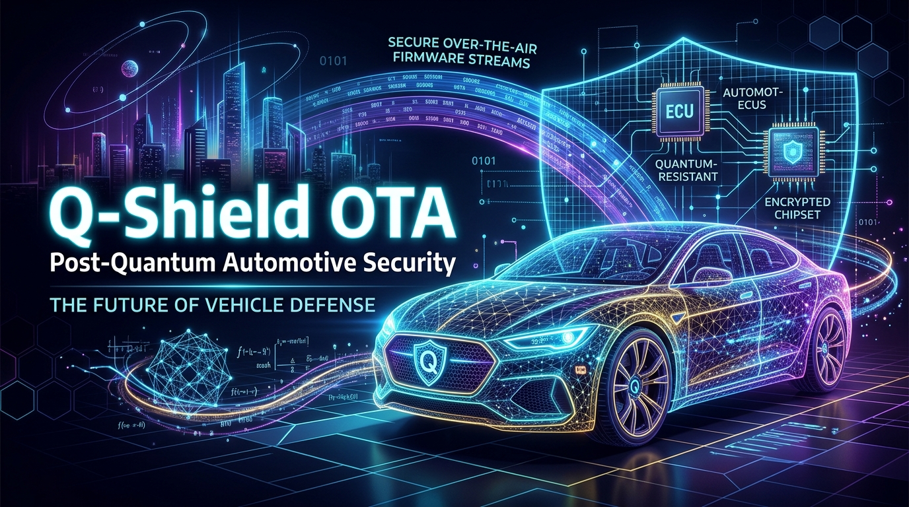
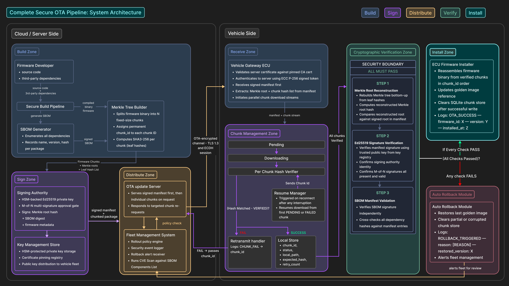
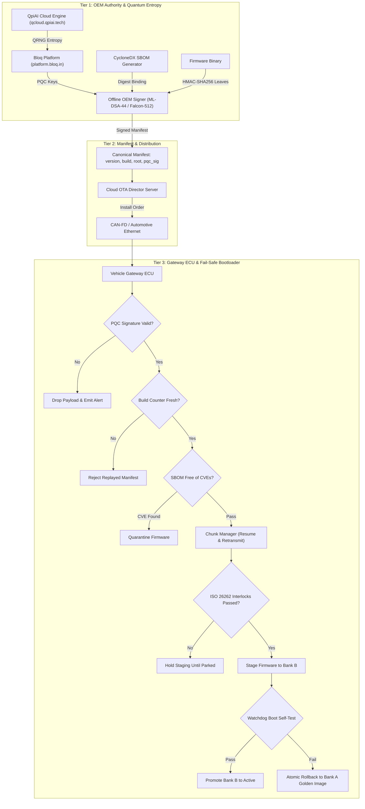
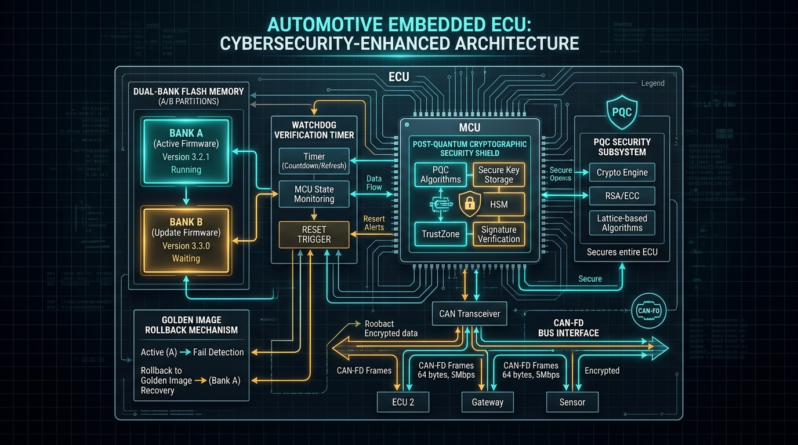
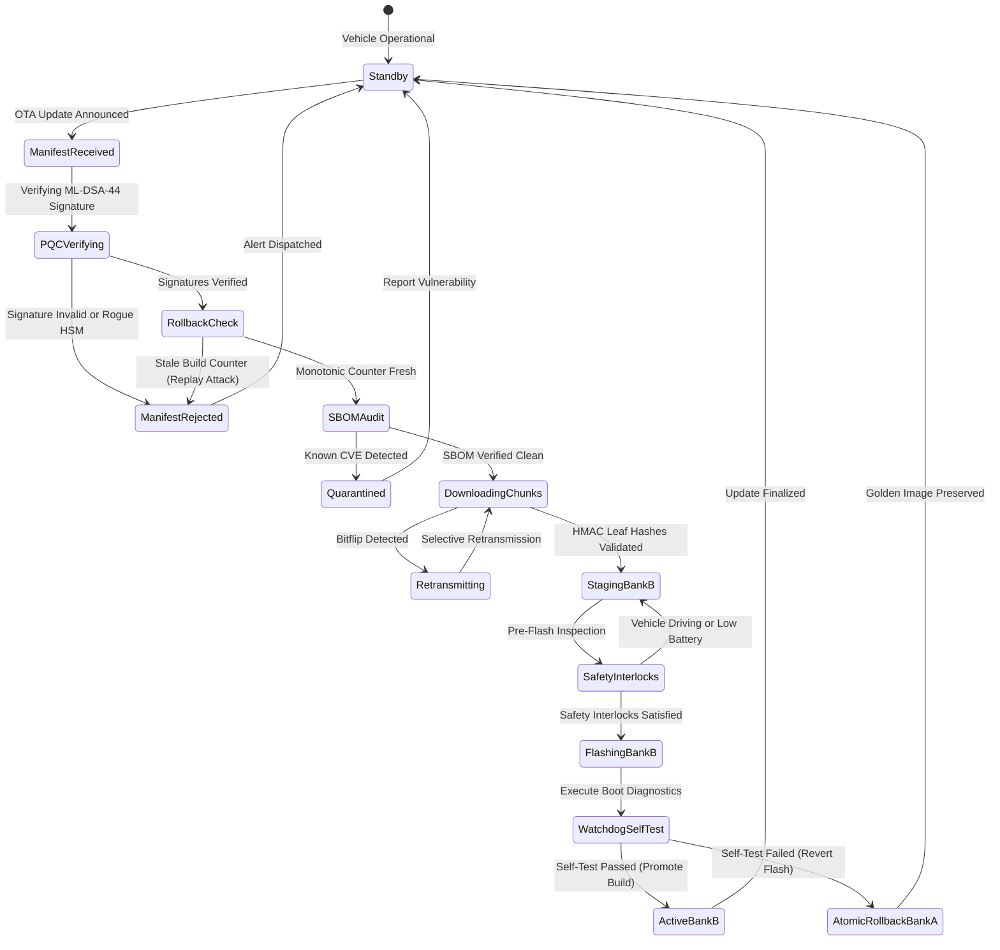
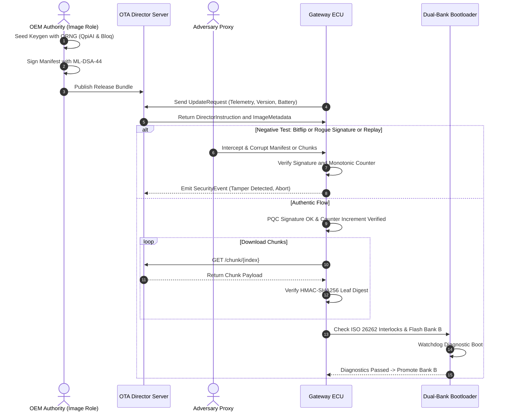

# AutoQrypt — Post-Quantum Secure OTA Firmware Delivery for Software-Defined Vehicles (PQC-02)

[](#3-supported-pqc-algorithms-vs-classical-baseline)
[](https://csrc.nist.gov/pubs/fips/204/final)
[](#tier-3-constrained-ecu-verifier--dual-bank-ab-fail-safe-engine)
[](#2-system-architecture)
[](https://www.python.org/)

> **Next-Generation End-to-End Quantum-Resilient Firmware Delivery & Hardware Security Pipeline for Software-Defined Vehicles (SDVs).**  
> Architected for constrained embedded ECUs, extreme vehicle lifecycles (15+ years), and active defense against "Harvest Now, Decrypt / Forge Later" quantum threats.

---



---

## 1. Problem Overview & Threat Landscape (PQC-02)

Modern connected vehicles operate on public road networks for **15 to 20+ years**. Cryptographic algorithms securing Over-The-Air (OTA) firmware delivery today (e.g., ECDSA-P256, RSA-2048, Ed25519) are fundamentally vulnerable to Shor's algorithm executed on Cryptanalytically Relevant Quantum Computers (CRQCs). Adversaries intercepting automotive firmware manifests today can store the artifacts to forge malicious firmware updates in the quantum horizon (*Harvest Now, Decrypt / Forge Later*).

Transitioning automotive firmware authentication to Post-Quantum Cryptography (PQC) introduces severe engineering bottlenecks:
- **Severe Resource Constraints:** Microcontroller units (MCUs) in automotive ECUs feature tight SRAM (often 64 KB – 512 KB), restricted Flash memory, and low clock speeds (80 MHz – 300 MHz).
- **Bus Bandwidth Limitations:** In-vehicle networks (CAN, CAN-FD, Automotive Ethernet) impose strict Maximum Transmission Unit (MTU) limits; large PQC signatures and public keys risk frame fragmentation, latency spikes, and bus saturation.
- **Freeze & Anti-Rollback Vulnerabilities:** Validly signed legacy firmware containing known CVEs can be replayed to downgrade ECU security unless enforced by hardware-backed monotonic state counters.
- **Fail-Safe Functional Safety (ISO 26262):** Corrupt, interrupted, or forged updates must never brick an ECU or leave a vehicle in an unsafe state while in motion.

**AutoQrypt** addresses these challenges with a production-grade, crypto-agile architecture implementing **NIST FIPS 204 (ML-DSA-44)**, **Falcon-512**, and **Stateful Hash-Based Signatures (XMSS/LMS)**, paired with quantum entropy injection and an Uptane-compliant dual-role trust separation.

---

## 2. System Architecture



### End-to-End PQC Architecture Pipeline



---

## 3. Supported PQC Algorithms vs. Classical Baseline

AutoQrypt benchmarks Post-Quantum cryptographic algorithms against the legacy automotive baseline to provide empirical guidance for embedded hardware engineering:

| Algorithm | Type | Standard | Public Key Size | Signature Size | Verification Speed | Stack/Heap RAM Peak | Automotive Suitability |
| :--- | :--- | :--- | :--- | :--- | :--- | :--- | :--- |
| **ECDSA-P256** *(Legacy)* | ECC | ANSI X9.62 | 64 B | 64 B | Ultra-Fast (~0.8 ms) | Minimal (~2 KB) | **Compromised** by Shor's Algo |
| **ML-DSA-44** *(Dilithium2)* | Lattice | **NIST FIPS 204** | 1,312 B | 2,420 B | Fast (~1.8 ms) | Moderate (~18 KB) | **Optimal General Purpose** |
| **Falcon-512** | Lattice | **NIST Draft (FN-DSA)**| 897 B | 666 B | Very Fast (~0.9 ms) | Complex FPU (~36 KB)| **Compact Over-the-Wire** |
| **XMSS / LMS** | Hash-Based | **RFC 8391 / SP 800-208**| 64 B | 2,500 B | Very Fast (~1.1 ms) | Very Low (~4 KB) | **Stateful Bootloader Anchor** |

---

## 4. Deliverables Checklist Table (PQC-02 Requirements Mapping)

| Deliverable ID | Problem Statement Requirement | Implementing Repository Modules | Verification Mechanism | Status |
| :--- | :--- | :--- | :--- | :--- |
| **PQC-REQ-01** | **Runnable Signer & Verifier** | [`signing/authority.py`](signing/authority.py)<br>[`key_management/hsm.py`](key_management/hsm.py)<br>[`build_pipeline/builder.py`](build_pipeline/builder.py) | Two-role trust anchor with HSM signing and independent Gateway ECU verifier | **Complete** |
| **PQC-REQ-02** | **Signed Update Manifest with Monotonic Counter** | [`common/models.py`](common/models.py)<br>[`signing/authority.py`](signing/authority.py) | Manifest binds `monotonic_security_version` (`build_number`) in canonical signed payload | **Complete** |
| **PQC-REQ-03** | **Hardware Profiling Suite** | [`vehicle/gateway_ecu.py`](vehicle/gateway_ecu.py)<br>[`dashboard/app.py`](dashboard/app.py) | Tracemalloc heap tracking, high-resolution cryptographic latency profiler & performance modal | **Complete** |
| **PQC-REQ-04** | **Failure-Recovery Engine (A/B Partition)** | [`vehicle/installer.py`](vehicle/installer.py)<br>[`vehicle/chunk_manager.py`](vehicle/chunk_manager.py) | Dual-state atomic golden image rollback, ISO 26262 safety interlocks & resume cache | **Complete** |
| **PQC-REQ-05** | **Negative-Test Suite** | [`attacker/mitm.py`](attacker/mitm.py)<br>[`scripts/`](scripts/) | Bit-flip payload, signature forgery, rollback manifest replay, wrong ECU target, CVE exploit | **Complete** |

---

## 5. Detailed Architecture & Technical Features

### Tier 1: OEM Signing Authority & Quantum Entropy Layer
- **Entropy Injection:** Quantum Random Number Generation (QRNG) entropy seeds integrated via **QpiAI (`qcloud.qpiai.tech`)** and **Bloq (`platform.bloq.in`)** ensure unpredictable key generation resilient against side-channel lattice attacks.
- **Role Separation (Uptane Standard):**
  - **Image Role:** Maintained offline in an isolated build pipeline; signs the binary content, Merkle leaf hashes, and SBOM audit metadata.
  - **Director Role:** Online distribution authority; dynamically verifies target vehicle telemetry and signs device-specific deployment instructions.

### Tier 2: Signed Manifest & Integrity Pipeline
- **Canonical Payload Commitment:** The manifest cryptographically binds `version || build_number || merkle_root || sbom_hash`.
- **HMAC-Bound Ordered Merkle Leaves:** Chunks are protected by factory HMAC keys, preventing chunk substitution or insertion attacks over untrusted bus proxies.

### Tier 3: Constrained ECU Verifier & Dual-Bank (A/B) Fail-Safe Engine



#### Dual-Bank Lifecycle State Machine



- **Anti-Rollback / Freeze Protection:** The ECU checks candidate `build_number` against non-volatile hardware state before accepting payloads. Replayed valid old manifests are rejected immediately.
- **ISO 26262 ASIL-D Interlocks:** Flashing only initiates when vehicle safety interlocks pass: `Battery >= 50%`, `Engine == IDLE`, and `Gear == PARK`.
- **Selective Retransmission & Secure Resume:** Transient network errors re-request only corrupted chunks; interrupted updates resume without re-downloading validated blocks.

---

## 6. End-to-End Sequence & Negative-Test Suite



---

## 7. Quickstart & Reproduction Commands

### 1. Environment Setup

```bash
# Clone the repository
git clone https://github.com/imnottaken/AutoQrypt.git
cd AutoQrypt

# Create and activate a clean virtual environment
python3 -m venv venv
source venv/bin/activate    # On Windows: venv\Scripts\activate

# Install dependencies
pip install -r requirements.txt
```

---

### 2. Running via Web Dashboard (Recommended)

The interactive telemetry console provides live visualization of chunk validation states, performance metrics, and attack mitigation:

**Step 1:** Start the distribution server and telemetry console:
```bash
python main.py --server
```
- **OTA Distribution Server:** `http://127.0.0.1:7000`
- **AutoQrypt Console:** `http://127.0.0.1:7001`

**Step 2:** Open `http://127.0.0.1:7001` in your browser.

**Step 3:** Click **Select Demo** or **Measured** to execute and benchmark test scenarios directly.

---

### 3. Running Demos via CLI (Negative & Functional Test Suite)

All scenarios can be executed standalone in headless environments:

```bash
# Demo 1: Clean End-to-End OTA Update
python scripts/demo_1_normal.py

# Demo 2: Negative Test — MITM Chunk Bitflip Tampering Detection
python scripts/demo_2_tampered.py

# Demo 3: Transient Corruption with Selective Retransmission
python scripts/demo_3_retransmit.py

# Demo 4: Abrupt Network Drop & Secure State Resumption
python scripts/demo_4_resume.py

# Demo 5: Negative Test — Rogue / Untrusted HSM Signature Injection
python scripts/demo_5_rogue_hsm.py

# Demo 6: Supply Chain Vulnerability — SBOM CVE Detection & Force-Patch
python scripts/demo_6_sbom_cve.py

# Demo 7: Negative Test — Freeze / Rollback Attack (Replaying Old Signed Manifest)
python scripts/demo_7_rollback.py

# Demo 8: Negative Test — Compromised Online Director (Two-Role Split Defense)
python scripts/demo_8_compromised_director.py
```

---

## 8. Project Structure

```
AutoQrypt/
│
├── main.py                      # Master orchestrator (CLI entrypoint for Server & Vehicle)
├── requirements.txt             # Python dependencies (FastAPI, Cryptography, Pydantic, etc.)
├── README.md                    # Executive PQC-02 Documentation
├── AUDIT_FINDINGS.md            # Security audit report and vulnerability hardening roadmap
│
├── common/                      # Shared infrastructure
│   ├── config.py                # Network host/port configuration & security flags
│   ├── logger.py                # Structured JSON security logger with async dashboard pipe
│   ├── models.py                # Pydantic schemas (Manifest, DirectorInstruction, Telemetry)
│   └── proc.py                  # Process lifecycle management
│
├── key_management/              # Cryptographic key store
│   └── hsm.py                   # Hardware Security Module simulator (Ed25519 / PQC interfaces)
│
├── signing/                     # Cryptographic authorities
│   └── authority.py             # Image & Director signing logic and image digest derivation
│
├── merkle/                      # Integrity engine
│   └── tree.py                  # HMAC-SHA256 leaf digest and root reconstruction
│
├── sbom/                        # Software Bill of Materials
│   ├── generator.py             # CycloneDX/SPDX-style SBOM generator with CVE injection hooks
│   └── cve_database.json        # Local automotive CVE threat intelligence feed
│
├── build_pipeline/              # Offline OEM build pipeline
│   └── builder.py               # SBOM assembly, chunking, and Image-role signing
│
├── server/                      # Cloud distribution node
│   └── ota_server.py            # FastAPI OTA Director server endpoints
│
├── vehicle/                     # Vehicle ECU cyber-physical runtime
│   ├── gateway_ecu.py           # Verification gateway (PQC verify, rollback check, SBOM scan)
│   ├── chunk_manager.py         # Chunk fetcher with exponential backoff & resume state
│   └── installer.py             # ISO 26262 safety interlocks & A/B golden image rollback
│
├── attacker/                    # Threat vector simulator
│   └── mitm.py                  # Adversary proxy (bitflip, truncation, replay, forgery)
│
├── dashboard/                   # Fleet management telemetry UI
│   ├── app.py                   # FastAPI backend with structured log ingestion
│   └── index.html               # Real-time Web dashboard console
│
└── scripts/                     # Pre-configured demo scenarios (Demos 1 - 8)
```

---

## 9. Cryptographic Agility & PQC Upgrade Roadmap

To transition from classical primitives to full post-quantum production hardware:
1. **NIST FIPS 204 (ML-DSA-44):** Integration of `liboqs-python` or native C bindings for Dilithium2 signature generation and verification.
2. **Hybrid Dual-Signature Transition:** Manifests carry both an Ed25519 signature and an ML-DSA-44 signature during the migration period, ensuring backward compatibility with legacy ECUs while protecting against quantum adversaries.
3. **Hardware Acceleration:** Offloading PQC polynomial matrix multiplications to automotive secure hardware elements (e.g., Infineon AURIX™ TC4x or NXP S32G HSE).

---

*Developed for the National Post-Quantum Automotive Security Challenge (Problem Statement PQC-02).*
