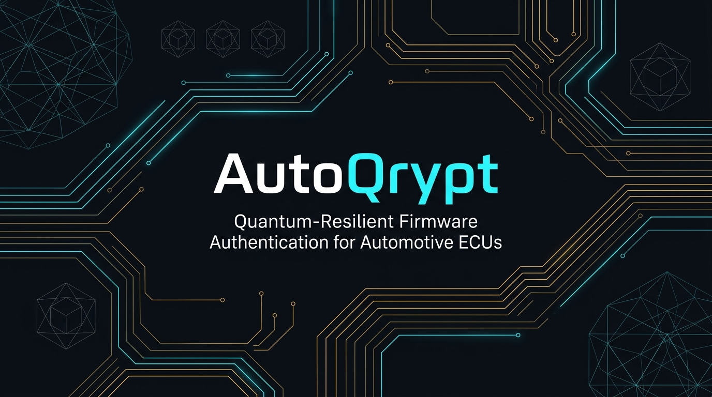

<p align="center">
  
</p>

<h3 align="center">Quantum-Resilient Dual-Role Firmware Authentication & Rollback Defense for Automotive ECUs</h3>

<p align="center">
  <strong>Problem Statement PQC-02: Automotive Firmware Authentication</strong><br>
  Built with QpiAI Quantum SDK & Bloq Platform
</p>

<p align="center">
  <a href="#the-problem-pqc-02">The Problem</a> •
  <a href="#pqt-hybrid-2fa-architecture">Architecture</a> •
  <a href="#cryptographic-specifications">Crypto Specs</a> •
  <a href="#end-to-end-workflow">Workflow</a> •
  <a href="#hardware-telemetry--hil-testbed">HIL Telemetry</a> •
  <a href="#quantum-integrations">Quantum Stack</a> •
  <a href="#attack--defense-scenarios">Scenarios</a> •
  <a href="#quickstart">Quickstart</a>
</p>

---

## The Problem (PQC-02)

Software-Defined Vehicles (SDVs) receive critical over-the-air (OTA) updates on Electronic Control Units (ECUs) controlling braking, powertrain, and ADAS. With the impending emergence of Cryptanalytically Relevant Quantum Computers (CRQCs), standard asymmetric algorithms (RSA, ECC/ECDSA) are provably vulnerable to Shor's algorithm.

Because automotive platforms operate over 15–20 year operational lifespans, firmware signed today must withstand quantum decryption and forgery throughout its operational life. However, deploying pure Post-Quantum Cryptography (PQC) poses serious practical obstacles:
1. **Cryptanalytic Risk**: Automotive OEMs consider pure PQC untested compared to decades of classical cryptanalysis.
2. **Resource Constraints**: High-tier PQC algorithms exceed the strict RAM (often < 512 KB), flash, and execution-time limits of embedded automotive silicon.
3. **Bus Bandwidth Overhead**: Large PQC signatures fragment automotive CAN / CAN-FD and LIN frames, inducing transmission latency and bus congestion.

---

## PQ/T Hybrid 2FA Architecture

AutoQrypt resolves these trade-offs by combining an **Uptane-aligned dual-role trust separation** with a **Post-Quantum / Traditional (PQ/T) Hybrid** signature scheme:

```
                          OEM INFRASTRUCTURE (Untrusted / Cloud / HSM)
    ┌──────────────────────────────────────────────────────────────────────────────────┐
    │  [ QpiAI Quantum SDK ]                                                           │
    │  Hadamard Superposition Circuit (QSV-Local / QCloud) ──► 256-bit Quantum Seed    │
    │                                                                   │              │
    │                                                     Key Generation Engine        │
    │                                            ┌──────────────────────┴────────────┐ │
    │                                            ▼                                   ▼ │
    │                                  Offline Image Signer             Online Director│
    │                           (ML-DSA-44 + Ed25519 + AES-256)           (Falcon-512) │
    └────────────────────────────────────────────┬───────────────────────────────────┬─┘
                                                 │ Signed Firmware                   │ Manifest
                                                 └─────────────────┬─────────────────┘
                                                                   │ OTA Bus Stream
                                                                   ▼
                                             AUTOMOTIVE ECU SURROGATE (ESP32-LX6)
    ┌──────────────────────────────────────────────────────────────────────────────────┐
    │ Streamed Chunks ──► Written to Inactive Partition (Flash Slot B)                 │
    │                                                                                  │
    │ On-Chip Cryptographic Verification Pipeline:                                     │
    │   1. HW AES-256-GCM In-Place Decryption                                          │
    │   2. Falcon-512 Director Signature Verification (Manifest targeting)             │
    │   3. ML-DSA-44 (NIST FIPS 204) Verification (Post-Quantum Image Auth)            │
    │   4. Ed25519 (RFC 8032) Verification (Classical Image Backup)                    │
    │   5. NVS Monotonic Counter Validation (Anti-Rollback Defense)                    │
    │                                                                                  │
    │ Verdict Execution:                                                               │
    │   ├─ SUCCESS: Atomic Partition Swap ──► Reboot Slot B (New Active Firmware)      │
    │   └─ FAILURE: Wipe Slot B Header ──► Reboot Slot A (Zero Downtime Golden Image)  │
    │                                                                                  │
    │ Real-Time Telemetry: Stack High-Water Mark & Clock Cycles Streamed to Dashboard  │
    └──────────────────────────────────────────────────────────────────────────────────┘
```

### Why PQ/T Hybrid 2FA?
Rather than replacing classical algorithms entirely, AutoQrypt stacks them as a two-factor cryptographic lock:
- **Classical Safety Net**: If a mathematical shortcut is discovered in lattice cryptography, classical `Ed25519` prevents unauthorized code execution.
- **Quantum Future-Proofing**: If a quantum adversary compromises classical keys via Shor’s algorithm, `ML-DSA-44` protects the vehicle.
- **Both signatures must validate independently.** A single cryptographic failure halts execution immediately.

---

## Cryptographic Specifications

| Layer | Primitive | Standard / Source | Key / Signature Footprint | Rationale / Automotive Benefit |
| :--- | :--- | :--- | :--- | :--- |
| **Entropy** | Quantum Superposition | `QpiAI Quantum SDK` | 256-bit root seed | True quantum entropy (Hadamard circuit) seeded into HSM |
| **Image (PQC)** | `ML-DSA-44` (Dilithium2) | NIST FIPS 204 | PubKey: 1,312 B<br>Sig: 2,420 B | Offline binary signature; lattice-based primary quantum defense |
| **Image (Classical)** | `Ed25519` | RFC 8032 | PubKey: 32 B<br>Sig: 64 B | Offline classical backup; proven 128-bit security floor |
| **Director (Online)** | `Falcon-512` | NIST Round 3 | PubKey: 897 B<br>Sig: ~666 B | Ultra-compact signature; fits into 11 CAN-FD frames with zero bus flood |
| **Confidentiality** | `AES-256-GCM` | NIST SP 800-38D | 256-bit Key, 96-bit IV | Encrypts proprietary vehicle calibration and code; HW accelerated |
| **Integrity & Hashing** | `SHA3-256` / `SHAKE256` | NIST FIPS 202 | 256-bit Digest | Grover-resistant preimage and collision resistance |

---

## End-to-End Workflow

```
   [1. Quantum Seed]          [2. Offline Image Sign]         [3. Online Director]
  QpiAI Quantum SDK          SHA3-256 Digest of Binary       Package Vehicle Target
          │                               │                            │
   Hadamard Circuit                Dual Signature:             Sign Manifest with
  (Superposition QRNG)          ML-DSA-44 + Ed25519             Falcon-512 Key
          │                               │                            │
 256-bit Root Seed               AES-256 Encryption                    │
          └───────────────────────────────┴────────────────────────────┤
                                                                       ▼
                                                          OTA Transmission Chunks
                                                                       │
   [6. Atomic Swap / Recovery]       [5. Telemetry Sync]               ▼
  PASS: Boot Slot B (Active)       uxTaskGetStackHighWaterMark   [4. ECU Verification]
  FAIL: Wipe Slot B, Boot Slot A   Clock Cycle Latency Probing   Stream to Flash Slot B
  Zero Downtime Fail-Safe       ◄── Real-time Dashboard Sync  ◄── Decrypt & Verify All
```

1. **Quantum Entropy Seeding**: `qpiai-quantum` builds an 8-qubit Hadamard superposition circuit ($H^{\otimes 8} |0\rangle^{\otimes 8}$) executed via `QpiAI-QSV-Local` or `qcloud.qpiai.tech`. The measured entropy is collapsed into a certified 256-bit root seed.
2. **Offline Binary Signing (Image Role)**: The compiled binary is hashed via `SHA3-256`, signed with both `ML-DSA-44` and `Ed25519`, and encrypted with `AES-256-GCM`. The Image key remains strictly air-gapped from network infrastructure.
3. **Online Manifest Dispatch (Director Role)**: The online OTA server generates installation manifests containing target ECU IDs, security versions, and image signatures, signed with `Falcon-512` for compact transit.
4. **ECU Ingestion & Decryption**: The ECU surrogate (ESP32) writes streamed chunks directly into flash partition Slot B to preserve internal SRAM, then invokes hardware AES-256-GCM decryption in place.
5. **Multi-Stage Verification**:
   - Manifest verified against pinned `Falcon-512` public key.
   - Firmware image verified against `ML-DSA-44` and `Ed25519` public keys.
   - Non-Volatile Storage (NVS) check verifies that `monotonic_security_version` strictly exceeds the active counter.
6. **Telemetry & Atomic Swap**:
   - Stack watermark and latency telemetry are captured and broadcast to the telemetry server.
   - On full pass: Bootloader switches active partition pointer to Slot B.
   - On fail / bitflip: Slot B is cleared; system reboots into Slot A with zero operational downtime.

---

## Hardware Telemetry & HIL Testbed

Automotive qualification requires hard mathematical proof that post-quantum algorithms execute safely within embedded memory envelopes without stack collisions or heap exhaustion.

```
                           ESP32-LX6 SILICON CONSTRAINTS
    ┌────────────────────────────────────────────────────────────────────────┐
    │ Available SRAM: 520 KB  │  Internal Flash: 4 MB  │  Clock: 240 MHz     │
    └────────────────────────────────────────────────────────────────────────┘
```

AutoQrypt profiles silicon behavior directly during execution:
- **Stack High-Water Mark (`uxTaskGetStackHighWaterMark`)**: Verifies that ML-DSA polynomial arithmetic stays strictly inside task boundaries.
- **Cycle-Accurate Latency Counters**: Benchmarks decryption and signature verification durations per algorithm.
- **Monotonic NVS Anti-Rollback**: Hardware flash counter prevents rollback attacks even if an older, validly-signed firmware image is replayed.
- **Fail-Safe Negative Testing**: Validates recovery from mid-flash power cuts, corrupted chunks, and tampered manifest payloads.

---

## Quantum Integrations

### 1. QpiAI Quantum SDK (`src/sponsors/qpiai_qcloud.py` & `src/sponsors/bloq_platform.py`)
- **Cloud Profile Sync & Local Solver Runtime**: Authenticates against `qcloud.qpiai.tech` (`QpiAIQuantumAuth.login`), pushes OpenQASM 2.0 circuits directly to the user's QpiAI Cloud profile (`POST /api/circuits/create`), and executes quantum circuits locally on `QpiAI-QSV-Local`.
- **Three Built-In `qpiai-quantum` Local Solvers**:
  1. **`qpiai_quantum.QRNG` (8-Qubit Hadamard Superposition)**: Generates 256-bit quantum entropy seeds audited against Shannon entropy and NIST SP 800-90B min-entropy (`> 5.0` bits/byte) to seed ML-DSA-44, Falcon-512, and Ed25519 OEM keys (`measurements/key_provenance.json`).
  2. **`qpiai_quantum.algorithms.opt.solvers.qaoa.QAOASolver` (5-Qubit Ising Cost Hamiltonian)**: Subclasses `OptimizationProblem` and runs parameterized QAOA circuits on `QpiAI-QSV-Local` to assign `Falcon-512` (Brake ASIL-D), `ML-DSA-44` (BMS), and `ML-DSA-44+SPHINCS+` (ADAS).
  3. **`qpiai_quantum.ShorsAlgorithm` (8-Qubit QFT Period Finding)**: Executes Quantum Fourier Transform period finding on `QpiAI-QSV-Local` to factor classical RSA modulus $N = 15 \to 3 \times 5$ ($r = 4$), empirically demonstrating why Gate 6 enforces lattice-based PQC.
- **Exported Artifacts**:
  - `dataset/qpiai_qrng_circuit.qasm`, `dataset/qpiai_qaoa_ecu_circuit.qasm`, `dataset/qpiai_shor_rsa_threat.qasm`
  - `dataset/qpiai_qrng_receipt.json` & `measurements/key_provenance.json`

### 2. Bloq Platform QUBO Optimizer (`src/sponsors/bloq_platform.py`)
- **Algorithmic Agility Formulation**: Models ECU hardware profiles (`dataset/ecu_hardware_profiles.json`) into a Quadratic Unconstrained Binary Optimization (QUBO) / Ising Hamiltonian balancing RAM, latency, and CAN-FD frame limits:
  $$\min \sum_{e,a} \left[ w_1 \frac{\text{RAM}_{e,a}}{\text{RAM}_e^{\max}} + w_2 \frac{\text{Frames}_{e,a}}{\text{Bandwidth}_e} + w_3 \frac{\text{Latency}_{e,a}}{\text{Deadline}_e} \right] x_{e,a} + \lambda \sum_e \left(1 - \sum_a x_{e,a}\right)^2$$
- **Exported Artifacts**:
  - `bloq_workspace/ecu_pqc_benchmark_dataset.csv`: Uploadable dataset for `platform.bloq.in`.
  - `bloq_workspace/qubo_matrix.json`: 15x15 QUBO coefficient matrix.
  - `notebooks/bloq_pqc_ota_optimizer.ipynb`: Self-contained Bloq Maya / Editor workflow.

---

## Attack & Defense Scenarios

AutoQrypt includes 8 automated test scenarios demonstrating attack mitigation:

| Script | Scenario Tested | Security Defense Validated |
| :--- | :--- | :--- |
| `demo_1_normal.py` | Baseline clean OTA update | Full PQ/T hybrid pipeline & A/B partition swap |
| `demo_2_tampered.py` | In-flight payload bitflip | Leaf digest mismatch & instant chunk rejection |
| `demo_3_retransmit.py` | Transient bus packet loss | State-machine selective chunk retransmission |
| `demo_4_resume.py` | Network connection severance | Resumption from persisted verification state |
| `demo_5_rogue_hsm.py` | Untrusted root signing attempt | Public key pinning failure; immediate rejection |
| `demo_6_sbom_cve.py` | Vulnerable dependency injection | Supply-chain SBOM audit against CVE database |
| `demo_7_rollback.py` | Replay of valid older release | Monotonic NVS counter rollback defense |
| `demo_8_compromised_director.py`| Attacker captures Director key | Image Role offline key isolation prevents forged payload |

---

## Repository Structure

```
AutoQrypt/
├── images/                 # Architecture diagrams, headers, and schematics
├── cloud/                  # OEM microservices & key generation
│   ├── build_pipeline/     # Firmware assembly & dual-signing pipeline
│   ├── server/             # FastAPI online Director service
│   ├── key_management/     # HSM interface with PQC & QRNG support
│   └── signing/            # Signing authority implementations
├── vehicle/                # Target ECU runtime & HIL surrogate
│   ├── gateway_ecu.py      # Verification state machine & A/B manager
│   ├── chunk_manager.py    # Chunk reassembly & selective retransmission
│   └── installer.py        # Rollback check & atomic partition activator
├── src/sponsors/           # Quantum platform connectors
│   ├── qpiai_qcloud.py     # QpiAI QRNG entropy engine
│   └── bloq_platform.py    # Bloq QUBO crypto-agility optimizer
├── dashboard/              # Real-time telemetry web console
├── dataset/                # ECU hardware profiles, QASM circuit, QRNG receipt
├── bloq_workspace/         # Bloq platform uploadable datasets & QUBO matrices
├── scripts/                # Automated attack & defense demo suites (1–8)
└── tests/                  # Sponsor integration test suite
```

---

## Quickstart

### Prerequisites
- Python 3.10+
- Optional: ESP-IDF v5.1+ for flashing physical ESP32 target silicon

### 1. Environment Setup
```bash
git clone https://github.com/imnottaken/AutoQrypt.git
cd AutoQrypt

python3 -m venv venv
source venv/bin/activate    # Windows: venv\Scripts\activate

pip install -r requirements.txt
```

### 2. Verify Quantum Integrations
```bash
python3 tests/test_sponsors.py
```

### 3. Launch Live Telemetry Server & Dashboard
```bash
python main.py --server
```
Navigate to `http://127.0.0.1:7001` in your browser to view the real-time ECU telemetry console.

### 4. Execute a Demonstration Scenario
In a separate terminal:
```bash
# Clean baseline update with dual PQ/T verification
python scripts/demo_1_normal.py

# Or test rollback mitigation:
python scripts/demo_7_rollback.py
```

---

## Standards & Compliance

AutoQrypt implements specifications defined by:
- **NIST FIPS 204**: Module-Lattice-Based Digital Signature Standard (`ML-DSA`).
- **NIST FIPS 202**: SHA-3 Standard: Permutation-Based Hash and Extendable-Output Functions.
- **Uptane (IEEE-ISTO 6100)**: Security design for automotive firmware updates.
- **ISO/SAE 21434**: Road vehicles — Cybersecurity engineering.
- **ISO 26262**: Road vehicles — Functional safety (pre-flash safety interlocks).

---

## License

Apache 2.0 License. See [LICENSE](LICENSE) for details.
